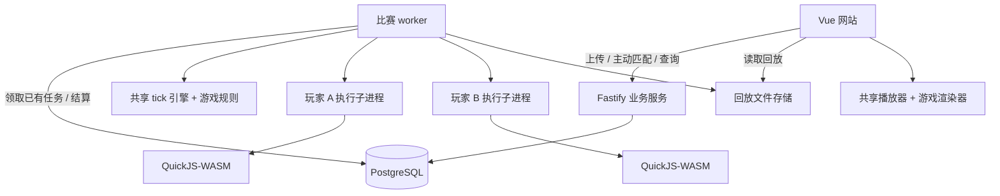

# 系统架构与技术选型

## 技术栈

| 层次 | 选型与职责 |
| --- | --- |
| 前端 | Vue 3 + TypeScript + Vite + Vue Router + Tailwind CSS |
| 包管理 | pnpm 12 workspace，以 pnpm 脚本编排构建，不额外引入 monorepo 框架 |
| 业务 API | Node.js 26 + TypeScript + Fastify 5 |
| 数据 | PostgreSQL 18 + Drizzle ORM + node-postgres |
| 任务 | 首版 PostgreSQL 任务表，短事务领取、租约、幂等终态 |
| 比赛运行 | 独立 Node.js worker，调用共享引擎和游戏包 |
| 玩家执行 | quickjs-emscripten 同步发行版，QuickJS-WASM，独立执行子进程 |
| 可视化 | 通用 Vue 播放器 + 游戏 renderer；首款网格游戏使用 Canvas |

选择 Fastify 是为了直接实现业务 API，并与前端、引擎、本地工具共享 TS 协议和包。它的插件和 schema 机制用于组织可信服务代码，不把 Fastify 插件等同于游戏插件。[Fastify 文档](https://fastify.dev/docs/latest/Reference/)

PostgreSQL 的事务同时覆盖比赛终态与双方排位更新。Drizzle 提供 TS 查询及迁移能力，直接使用 PostgreSQL 驱动。[Drizzle 文档](https://orm.drizzle.team/docs/get-started-postgresql)

系统使用 PostgreSQL 任务表，不引入 Redis、Kafka、微服务网关或模型 API。增加 worker 数量只改变任务处理能力，不能改变“用户主动发起才开赛”的语义。

## 系统关系

## 职责划分

### 业务服务

负责身份认证、官方账号标记、游戏列表、最新代码上传、主动匹配、榜单和比赛查询。上传只做体积、编码、语法及入口格式检查，不通过执行用户代码完成校验，不创建试跑比赛。

匹配请求选择对手并创建任务。系统中不存在周期性扫描选手并创建新比赛的路径。网页查询比赛状态使用 GET，不隐式触发 POST 匹配。

### 比赛 worker

领取已存在任务，读取本场代码到内存，加载可信游戏规则，驱动 tick，调用玩家执行子进程，生成回放并结算。

worker 持有权威世界和最近成功的 Memory，玩家执行进程不持有业务凭证。一个玩家执行进程异常不能销毁另一个玩家的执行进程，也不能直接修改世界。

### 游戏规则与玩家代码

游戏规则是经过平台审核、随仓库构建的可信模块，在引擎侧运行。玩家代码只能看到序列化观察和自己的 Memory，通过返回动作影响世界，不直接调用数据库、文件或渲染器。

规则引擎自身崩溃属于系统失败；玩家 JS 抛异常属于比赛内错误，二者不能混为一类。

## 任务生命周期

`pending → running → completed`，系统失败进入 `failed`。

- API 显式创建 `pending`，worker 通过短事务领取，写入租约与执行标识。
- worker 执行期间续租；数据库锁不跨越整场比赛持有。
- `pending` 尚未开始的任务可以重新领取。
- `running` 的主 worker 失联且无法证明执行结果完整时，本场标记失败、不计分。
- 玩家执行子进程丢失时，只记录该玩家 tick 失败并重建，不等同于主 worker 丢失。
- 完整回放和最终结果已可靠形成且执行租约有效时，允许重试保存与幂等结算；失去租约不得提交。
- 已排队比赛开局前发现最新代码不再兼容其冻结发行时，以 ENTRY_CHANGED_BEFORE_START 失败、不计分，不强行运行或自动换规则。

不保存历史源码意味着无法保证重跑崩溃比赛仍使用旧代码，因此不声称支持执行中的比赛透明恢复。用户可重新主动匹配，产生一个新的比赛 ID。

任务领取可使用 PostgreSQL `FOR UPDATE SKIP LOCKED`，其用途限于任务竞争，不用于普通一致性读取。[PostgreSQL 文档](https://www.postgresql.org/docs/current/sql-select.html)

## 部署与存储

采用 Linux 单机部署，API、主 worker 和玩家执行子进程具有独立生命周期。PostgreSQL 为独立依赖，回放保存到受控数据目录，数据库保存文件引用及摘要。每个 worker 同时执行 2 场圈地比赛。具体部署形态、镜像编排与上线步骤见 [部署与发布](deployment.md)。

比赛创建时固定规则发行、实际配置和完整 resolvedLimits；worker 只领取本机已安装且资源容量可满足的发行。每位玩家的最新代码在开局时按该冻结协议再次检查。发行标识不等于代码兼容版本，兼容规则见 [游戏模块](monorepo-and-modules.md)。

线上执行环境使用 Linux 与 cgroup v2，玩家执行子进程具有独立资源组、独立网络命名空间、只读运行文件系统、低权限用户和运行器的 seccomp 配置，不继承 API/数据库密钥。资源组的 `memory.max` 使用该游戏发行的 `resolvedLimits.processMemoryBytes`（平台默认 268435456，即 256MiB），同时设置 `memory.swap.max=0` 和 `pids.max=16`。隔离设施无法建立时拒绝启动比赛执行服务，不回退到无隔离执行。

本地 CLI 复用相同执行代码，但不要求用户安装 PostgreSQL 或运行平台服务。可移植性与操作系统级隔离能力是两回事，不能把本地默认运行方式直接当作线上配置。

## 相关文档

- [Monorepo 与游戏模块](monorepo-and-modules.md)
- [沙箱](sandbox.md)
- [数据模型与 API](data-model-and-api.md)
